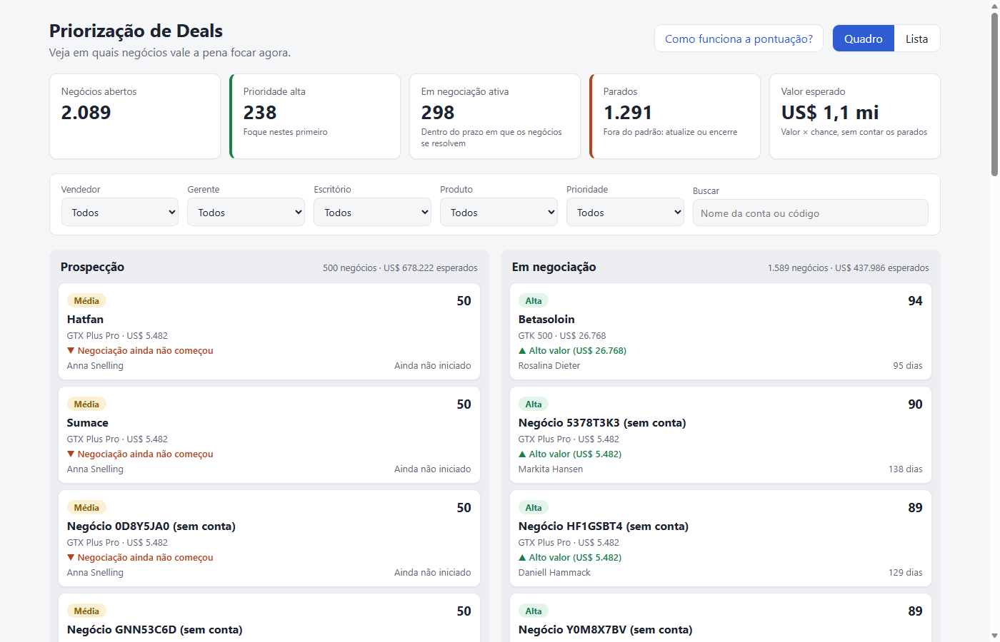
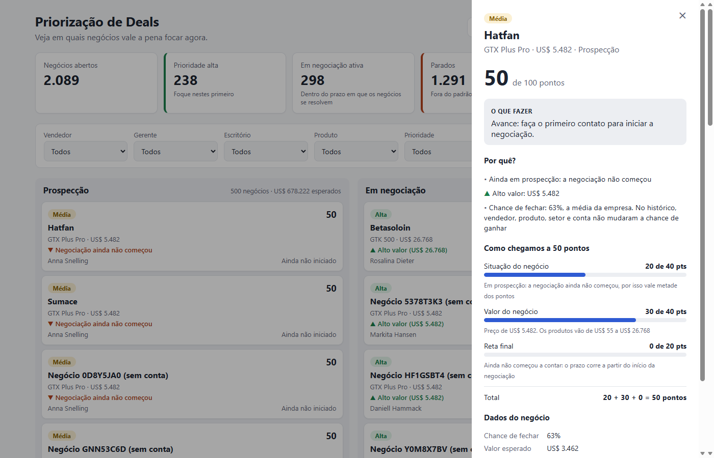
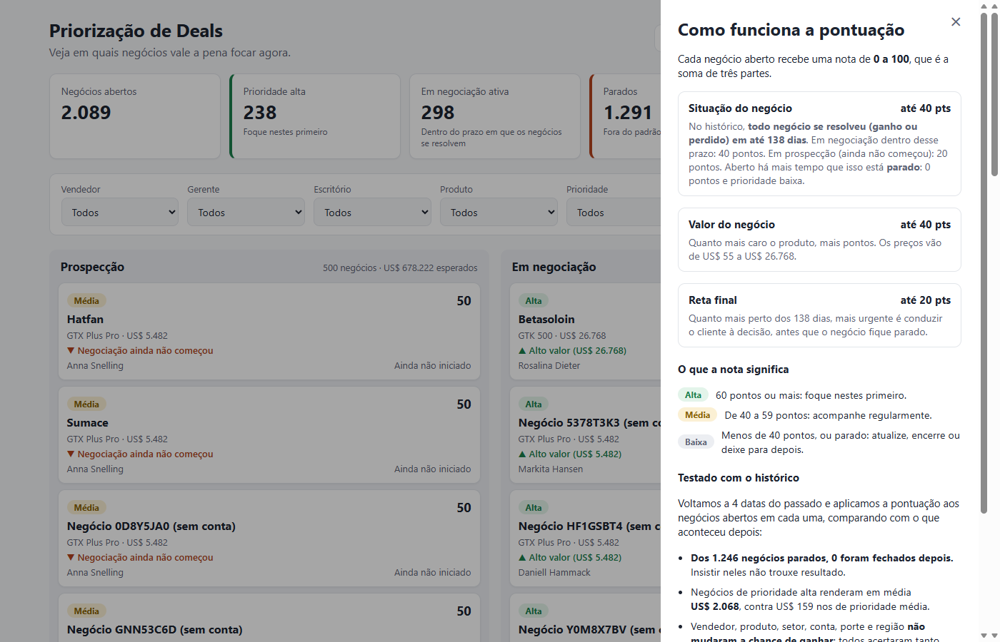

# Submissão — Rodrigo Santos — Challenge 003

## Sobre mim

- **Nome:** Rodrigo Santos
- **LinkedIn:** https://www.linkedin.com/in/rodrigo-dos-santos/
- **Challenge escolhido:** 003 — Lead Scorer (Vendas / RevOps)

---

## Executive Summary

Construí uma aplicação web (FastAPI + React) que o vendedor abre e já vê o pipeline ordenado por prioridade. Cada negócio tem uma nota de 0 a 100 com a conta à mostra (ex.: 40 + 40 + 14 = 94), o principal motivo e o que fazer. Antes de fechar a lógica, **testei a pontuação contra o histórico (backtest)**, e o resultado mudou a solução:

1. **Nenhum atributo do dataset prevê quem ganha.** Vendedor, produto, setor, conta, porte, região e até vendedor × produto acertam tanto quanto um sorteio (AUC ≈ 0,5).
2. **O sinal real é o negócio parado.** Nenhum negócio do histórico ficou aberto mais de 138 dias, e dos 1.246 que passaram disso nos cortes testados, **nenhum fechou depois**.

Hoje, **1.291 dos 1.589 negócios "em negociação" (81%) estão parados**. A recomendação é focar nos **238 negócios de prioridade alta**, que no backtest renderam 13 vezes mais receita por negócio que os de prioridade média, e fazer uma limpeza ativa dos parados.



---

## Solução

Código, dados e instruções em [`solution/`](solution/). Detalhes técnicos em [`solution/README.md`](solution/README.md).

### Como rodar

Só é preciso **Python 3.10 ou mais novo** (testado em 3.10, 3.12, 3.13 e 3.14). A tela já vem compilada e é servida pela própria API.

**Windows (PowerShell ou CMD)**, a partir desta pasta:

```
cd solution\backend
python -m venv .venv
.venv\Scripts\python -m pip install -r requirements.txt
.venv\Scripts\python -m uvicorn app.main:app
```

**Mac / Linux**, a partir desta pasta:

```
cd solution/backend
python3 -m venv .venv
.venv/bin/python -m pip install -r requirements.txt
.venv/bin/python -m uvicorn app.main:app
```

Abra **http://localhost:8000**.

Para desenvolver a tela com Node.js, rodar os testes (30) ou resolver problemas comuns, veja [`solution/README.md`](solution/README.md#como-rodar).

### Abordagem

1. **Entender os dados antes de modelar.** Perfilei as 4 tabelas e encontrei:
   - inconsistências: o produto `GTXPro` no pipeline não casa com `GTX Pro` no catálogo, e o setor `technolgy` está escrito errado;
   - 1.425 negócios abertos sem conta;
   - negócios abertos sem valor de fechamento;
   - dados que terminam em 2017, então "hoje" precisa ser a última data do dataset.
2. **Primeira versão, pelo caminho "óbvio".** A nota combinava a chance histórica por vendedor, produto, setor e conta (35 pts), o valor (35 pts) e o ritmo (30 pts, penalizando negócios a partir de 88 dias). Funcionava e era explicável. Mas eu não sabia se estava **certa**.
3. **Validar antes de entregar.** Criei um backtest sem vazamento de dados. Em 4 datas do passado, as estatísticas usam só o que já tinha fechado; pontuei os negócios em andamento naquele dia e comparei com o que aconteceu depois. Resultado:
   - a chance por vendedor, produto, setor ou conta **não previa nada** (AUC de 0,45 a 0,50); as diferenças entre vendedores são compatíveis com o acaso (2 de 30 fora da margem, quando ~1,4 seria esperado);
   - a penalidade por tempo estava **errada no meio do ciclo**: um negócio ainda aberto aos 120 dias ganha **mais** (76%) que um recém-aberto (63%), porque as perdas acontecem cedo;
   - o sinal verdadeiro é o **limite**: nenhum negócio, ganho ou perdido, durou mais de 138 dias, e nenhum que passou disso fechou depois.
4. **Refazer a lógica com base na evidência** e deixar a validação no produto: um módulo testado, o relatório em [`docs/validacao.md`](docs/validacao.md) e a tela "Como funciona a pontuação", que mostra a evidência ao vendedor.
5. **Interface para quem não é técnico.** Quadro por etapa, selo de prioridade, motivo principal no cartão, painel "o que fazer / por quê / como chegamos à nota" e filtros por vendedor, gerente, escritório e produto.

### Lógica da pontuação

| Parte | Vale até | Critério | Por quê |
|---|---|---|---|
| Situação | 40 pts | Em negociação até 138 dias: 40 · Em prospecção: 20 · **Parado** (mais de 138 dias): 0 | É o único sinal que o backtest confirmou: parado não fecha |
| Valor | 40 pts | Preço do produto em escala logarítmica (US$ 55 a US$ 26.768) | Com a mesma chance para todos, o valor decide onde o tempo rende mais. Sem o log, só o produto mais caro importaria |
| Reta final | 20 pts | Para negócios ativos: tempo aberto ÷ 138 dias | Perto do prazo, o negócio precisa de uma decisão antes de virar parado. E, nos dados, quem chega lá ganha mais |

- **Prioridade:** Alta ≥ 60 · Média ≥ 40 · Baixa < 40. **Parado é sempre Baixa**, com a ação "atualize ou encerre".
- **Valor esperado** = chance × valor. A chance é a média da empresa (63%) para todos os vivos, e 0 para os parados.
- **A chance individual não entra na nota**, e a tela explica isso ao vendedor, para que ele não priorize por "achismo" de que um produto ou cliente fecha mais.
- Pontos e limites ficam em [`config.py`](solution/backend/app/config.py), e a tela de explicação lê os valores direto da API.

### Resultados

| | |
|---|---|
|  |  |

- **2.089 negócios abertos** pontuados: **238 de prioridade alta**, 273 média e 1.578 baixa (1.291 deles parados).
- **Valor esperado realista: US$ 1,1 mi.** A primeira versão mostrava US$ 3,1 mi, porque contava os parados.
- **Backtest** ([relatório completo](docs/validacao.md)):

| Prioridade no dia do corte | Negócios resolvidos depois | Taxa de vitória | Receita média por negócio |
|---|---|---|---|
| Alta | 2.956 | 65,3% | **US$ 2.068** |
| Média | 1.126 | 67,0% | US$ 159 |
| Parados (todas as datas) | 1.246 | **nenhum fechou** | US$ 0 |

- Cada negócio mostra os pontos de cada parte, os motivos em linguagem simples e uma ação. Exemplos: "Parado há 163 dias: nenhum negócio do histórico ficou aberto mais de 138 dias…" → "Atualize ou encerre". "Na reta final: está no dia 120…" → "Priorize agora".
- Funciona no celular e tem filtros por vendedor, gerente, escritório, produto, prioridade e busca.

### Recomendações

1. **Segunda-feira de manhã:** cada vendedor filtra o próprio nome e trabalha primeiro os negócios de prioridade alta, começando pelos que estão na reta final.
2. **Limpeza do pipeline, já:** os 1.291 negócios parados devem receber um último contato ou ser marcados como perdidos. Eles somam 81% do que está "em negociação" e, no histórico, nunca fecharam. Hoje distorcem previsões e consomem atenção.
3. **Regra de processo:** todo negócio que chegar a ~120 dias sem decisão precisa de uma conversa de fechamento ou encerramento. O sistema já sinaliza isso como "reta final".
4. **Coletar dados que realmente preveem:** os campos atuais não diferenciam ganho de perda. Registrar atividades (reuniões, respostas do cliente, mudanças de etapa) e tornar a conta obrigatória (1.425 negócios abertos estão sem ela) é o que permitiria um modelo preditivo de verdade.

### Limitações

- **A ferramenta não prevê quem vai ganhar entre os negócios vivos**, porque os dados não permitem: testei 11 atributos e combinações, e todos ficaram no nível do sorteio. A prioridade se baseia no que é verificável: estar vivo, valor e urgência.
- **O backtest não cobre a prospecção**, porque esses negócios não têm data de início e não dá para saber como estavam no passado.
- **"Parado" é um padrão estatístico, não uma certeza.** Pode haver um negócio legítimo de ciclo longo; por isso a ação é "confirme com o cliente", não "apague".
- **Os dados são de 2017**, então "hoje" é a última data do dataset (configurável em `config.py`).
- **Ainda não está pronta para produção:** não tem login nem banco, e os dados são CSVs carregados em memória. A arquitetura isola esses pontos: a fonte de dados está só em `carregador.py` e a lógica só em `pontuacao.py`, e a validação roda de novo com um comando.

---

## Process Log — Como usei IA

> O registro completo da conversa está em [`process-log/`](process-log/).

### Ferramentas usadas

| Ferramenta | Para que usou |
|------------|--------------|
| Claude Code (extensão do VS Code, modelo Claude Opus) | Planejamento, análise exploratória, backtest, backend, frontend, testes automatizados, teste no navegador (Edge headless), testes em várias versões de Python e fluxo de git |

### Workflow

1. **Briefing:** passei ao Claude o problema como recebi (vendedores perdendo tempo com negócios que não fecham), os requisitos (pipeline claro para quem não é técnico, começar simples, código limpo e comentado) e a estrutura dos dados.
2. **Planejamento (modo de plano):** o Claude perfilou os CSVs antes de propor código e me fez duas perguntas. Decidi **FastAPI + React** pela manutenção e expansão, e **tudo em português** para o time que vai manter.
3. **Versão 1:** backend, API, frontend e testes. O Claude subiu os servidores, testou a API e conferiu a tela por captura.
4. **Iteração de explicabilidade:** cobrei que o vendedor precisa entender por que uma nota é alta e outra baixa. Vieram os pontos por parte que somam a nota, o motivo principal no cartão e a tela "Como funciona a pontuação".
5. **Iteração "roda em qualquer máquina":** exigi que quem recebesse o código conseguisse rodar sem erro. O Claude clonou o repositório do zero e testou em Python 3.10, 3.12, 3.13 e 3.14 e no navegador, encontrando e corrigindo problemas reais (abaixo).
6. **Iteração de validação:** pedi o backtest para dar clareza ao projeto. Ele mostrou que parte da lógica estava errada. Decidi refazer a pontuação com base na evidência, em vez de só registrar a falha como limitação.
7. **Submissão:** fork, branch e estrutura `submissions/rodrigo-santos/`, seguindo o guia do desafio.

### Onde a IA errou e como corrigi

- **A lógica da v1 parecia boa, mas não se sustentava.** A IA montou uma chance por vendedor, produto, setor e conta e uma penalidade a partir de 88 dias, ambas plausíveis e bem explicadas. O backtest mostrou que a chance não prevê nada (AUC ≈ 0,5) e que a penalidade estava invertida no meio do ciclo. **Sem a validação, a ferramenta diria ao vendedor que "Maureen fecha 69%" como se isso importasse.** A lógica foi refeita.
- **Valor esperado inflado:** US$ 3,1 mi, quando 67% estava em negócios parados. Corrigido para US$ 1,1 mi.
- **A primeira entrega não explicava a nota.** Os fatores não somavam a nota e o cartão não mostrava motivo. Refeito como uma soma de pontos visível.
- **Não instalava no Python 3.14:** a versão fixa do pandas não tinha pacote pronto. Encontrado no teste com clone novo e corrigido com faixas de versão.
- **README com comandos que falham no Windows:** `&&` no PowerShell 5.1 e ativação do venv bloqueada. Reescrito com comandos por sistema operacional.
- **Detalhes de interface:**
  - cartões mostravam só "Conta não informada";
  - um texto presumia o gênero do vendedor;
  - aparecia um erro 404 de favicon no console;
  - havia uma diferença de arredondamento de 1 ponto entre a soma e a nota.

  Todos corrigidos.
- **Ambiente:**
  - a porta 5173 estava ocupada por outra aplicação;
  - o proxy do Vite usava `localhost`, que no Node 22 resolve para IPv6;
  - o `.gitignore` do repositório original ignora `submissions/` (contornado com `git add -f`, sem alterar arquivos fora da pasta).

### O que eu adicionei que a IA sozinha não faria

- **O enquadramento do problema e o critério de sucesso:** uma ferramenta para vendedor que não é técnico, não um modelo.
- **As decisões de stack e de idioma**, pensando em quem vai manter o código.
- **A exigência de explicabilidade**, que levou à segunda versão.
- **A exigência de que rodasse de primeira para o avaliador**, que revelou incompatibilidades reais.
- **A decisão de validar e de refazer a lógica quando a validação a contrariou**, em vez de entregar a versão que "parecia certa". É a diferença entre a minha entrega e colar o enunciado numa IA.
- **A condução do processo em etapas** (solução → git → validação → documentação) e a revisão de cada entrega antes de seguir.

---

## Evidências

- [x] Chat export: registro da conversa em [`process-log/`](process-log/)
- [x] Screenshots em [`docs/`](docs/): pipeline, detalhe, "Como funciona", celular
- [x] Relatório de validação: [`docs/validacao.md`](docs/validacao.md), reproduzível com `python -m app.servicos.validacao`
- [x] Git history: commits na branch `submission/rodrigo-santos`
- [ ] Screen recording

---

_Submissão enviada em: outubro de 2026_
